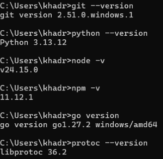
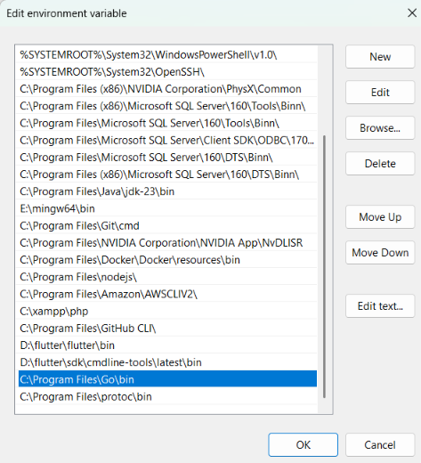
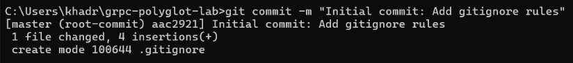
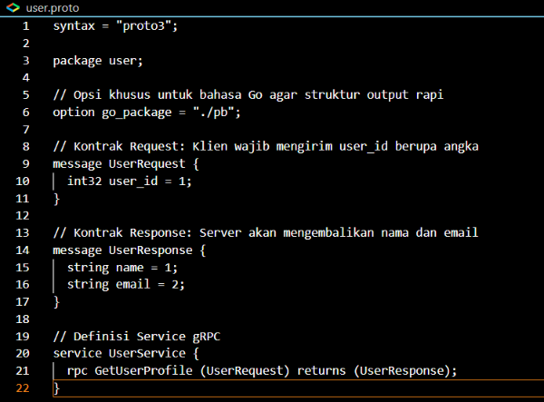
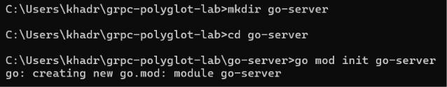
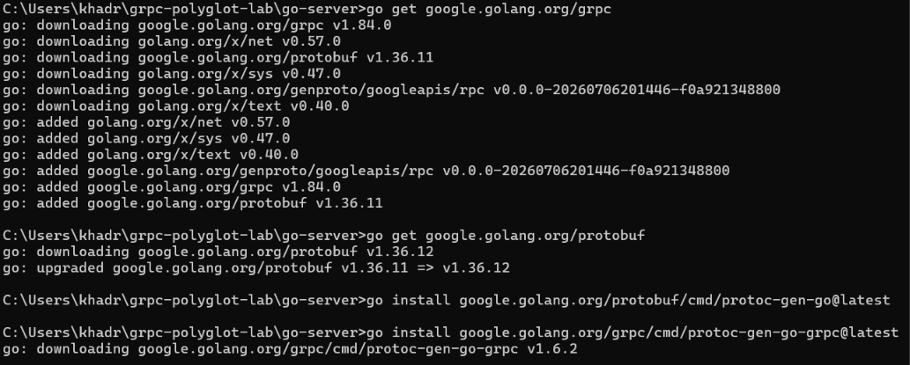
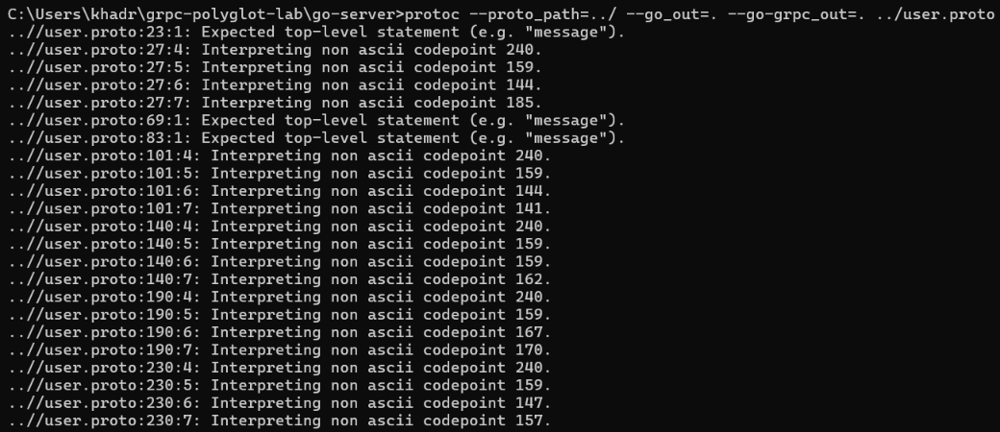
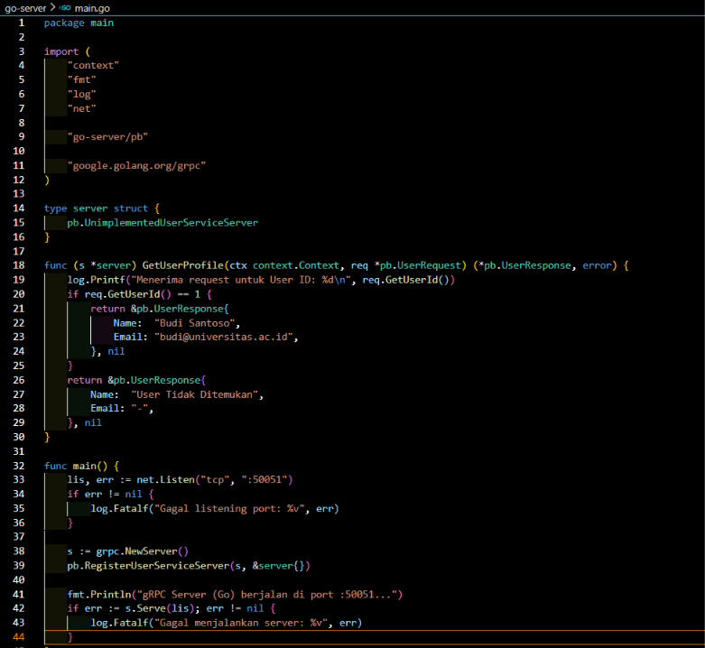
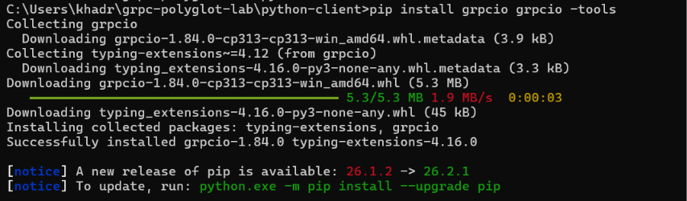
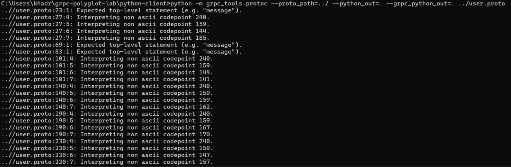

<div align="center">

## LAPORAN PRAKTIKUM Praktikum gRPC Polyglot


### Disusun Oleh:  
Nama               : Miftahul Qadri  
NIM                : 2024903430082 
Kelas              : TRKJ-3C


### Program Studi Teknologi Rekayasa Komputer Jaringan
### Jurusan Teknologi Informasi dan Komputer
### Politeknik Negeri Lhokseumawe
### 2026


---


## Lembar Pengesahan


| No. Praktikum     | : | 02 |
|------------------:|:-:|:--------------|
| Judul Praktikum   | : | Praktikum gRPC Polyglot |
| Tanggal Praktikum | : | 16 Oktober 2026 |
| Tanggal Penyerahan| : | 16 Oktober 2026 |
| Nama Praktikan    | : | Miftahul Qadri |
| NIM/Kelas Praktikan| : | 2024903430082 / TRKJ-3C |
| Nilai Praktikum   | : | .......................... |
| Dosen Pengampu    | : | Muhammad Reza Zulma, S.ST., M.Sc |

Mengetahui,  
Dosen Pengampu
<br><br><br><br><br>

Muhammad Reza Zulma, S.ST., M.Sc
</div>


## Daftar Isi
 
1. [Tujuan Pembelajaran](#1-tujuan-pembelajaran)
2. [Landasan Teori](#2-landasan-teori)
3. [Alat dan Bahan](#3-alat-dan-bahan)
4. [Struktur Proyek](#4-struktur-proyek)
5. [Langkah Praktikum](#5-langkah-praktikum)
   - [Bagian 0: Verifikasi Prasyarat](#bagian-0-verifikasi-prasyarat)
   - [Bagian 1: Setup Workspace dan Git](#bagian-1-setup-workspace-dan-git)
   - [Bagian 2: Menulis Kontrak API (`user.proto`)](#bagian-2-menulis-kontrak-api-userproto)
   - [Bagian 3: gRPC Server dengan Go](#bagian-3-grpc-server-dengan-go)
   - [Bagian 4: gRPC Client dengan Python](#bagian-4-grpc-client-dengan-python)
   - [Bagian 5: gRPC Client dengan Node.js](#bagian-5-grpc-client-dengan-nodejs)
   - [Bagian 6: Pengujian dan Push ke GitHub](#bagian-6-pengujian-dan-push-ke-github)
6. [Tugas Evaluasi Mandiri](#6-tugas-evaluasi-mandiri)
   - [Tugas 1: Menambah Field `phone`](#tugas-1-menambah-field-phone)
   - [Tugas 2: Analisis Static vs Dynamic Code Generation](#tugas-2-analisis-static-vs-dynamic-code-generation)
7. [Kendala dan Solusi](#7-kendala-dan-solusi)
8. [Kesimpulan](#8-kesimpulan)
9. [Daftar Screenshot](#9-daftar-screenshot)
> **Catatan:** Semua gambar pada laporan ini diambil dari folder `screenshots/`. Ganti file placeholder dengan screenshot hasil praktikum sendiri sesuai nama file yang tertera. Blok bagian **Output yang diharapkan** adalah contoh keluaran yang seharusnya muncul, bukan pengganti screenshot.
 
---
 
## 1. Tujuan Pembelajaran
 
1. Memahami arsitektur *Schema-First Development* menggunakan Protocol Buffers.
2. Mampu menginstalasi komponen compiler gRPC (`protoc`).
3. Berhasil membuat gRPC Server menggunakan Go.
4. Berhasil membuat gRPC Client menggunakan Python dan Node.js untuk berkomunikasi dengan server Go yang sama.
---
 
## 2. Landasan Teori
 
### 2.1 Apa itu gRPC
 
gRPC adalah kerangka kerja *Remote Procedure Call* (RPC) berkinerja tinggi yang dikembangkan oleh Google. gRPC memungkinkan layanan mikro (*microservices*) saling berkomunikasi seolah-olah memanggil fungsi lokal, meskipun berjalan pada mesin atau bahasa pemrograman yang berbeda.
 
### 2.2 Konsep Utama
 
| Konsep | Penjelasan |
|---|---|
| **Protocol Buffers (Protobuf)** | Format data biner yang didefinisikan lewat file `.proto`. Berbeda dengan REST yang memakai JSON berbasis teks. File `.proto` berfungsi sebagai *service contract* yang mendefinisikan struktur data dan metode yang tersedia. |
| **HTTP/2** | Protokol transport gRPC. Mendukung *multiplexing* (banyak permintaan dalam satu koneksi), komunikasi dua arah (*streaming*), dan kompresi header sehingga lebih cepat dan ringan dibanding HTTP/1.1. |
| **Code Generation** | Dari satu file `.proto`, `protoc` dapat menghasilkan kode klien dan server di berbagai bahasa. Ini menjaga konsistensi tipe data dan mempercepat integrasi lintas platform. |
| **Pola Komunikasi** | Mendukung *unary* (permintaan-respons biasa), *server streaming*, *client streaming*, dan *bidirectional streaming*. |
 
### 2.3 Schema-First Development
 
Pada pendekatan *schema-first*, kontrak API (`user.proto`) ditulis terlebih dahulu sebagai **Single Source of Truth**. Server dan semua klien kemudian dibangun dari kontrak yang sama, sehingga perbedaan bahasa pemrograman tidak menimbulkan ketidaksesuaian struktur data.
 
### 2.4 Arsitektur Praktikum
 
```
                 user.proto
          (Single Source of Truth)
                     |
     +---------------+----------------+
     |                                |
 static generate                 dynamic load
 (protoc)                        (proto-loader)
     |                                |
+----+-----+                     +----+-----+
|          |                     |          |
Go Server  Python Client         Node.js Client
(:50051)   ----gRPC/HTTP2---->   ----gRPC/HTTP2---->  Go Server
```
 
---
 
## 3. Alat dan Bahan
 
| Komponen | Keterangan |
|---|---|
| Sistem Operasi | Windows `11` |
| Terminal | Git Bash / Command Prompt |
| Editor | VS Code |
| Git | `2.51.0.windows.1` |
| Python | 3.10+ (`3.13.12`) |
| Node.js dan npm | LTS (`v24.15.0`) |
| Go | `go1.27.2 windows/amd64` |
| Protocol Buffers Compiler (`protoc`) | `libprotoc 36.2` |
| Library Go | `google.golang.org/grpc`, `google.golang.org/protobuf` |
| Library Python | `grpcio`, `grpcio-tools` |
| Library Node.js | `@grpc/grpc-js`, `@grpc/proto-loader` |
 
---
 
## 4. Struktur Proyek
 
```
grpc-polyglot-lab/
├── .gitignore
├── README.md
├── user.proto
├── screenshots/
├── go-server/
│   ├── go.mod
│   ├── go.sum
│   ├── main.go
│   └── pb/
│       ├── user.pb.go
│       └── user_grpc.pb.go
├── python-client/
│   ├── client.py
│   ├── user_pb2.py
│   └── user_pb2_grpc.py
└── node-client/
    ├── package.json
    ├── package-lock.json
    └── client.js
```
 
---
 
## 5. Langkah Praktikum
 
### Bagian 0: Verifikasi Prasyarat
 
Pastikan semua alat sudah terinstal dan dikenali oleh terminal.
 
```bash
git --version
python --version
node -v
npm -v
go version
protoc --version
```

 
**Output yang diharapkan** (versi dapat berbeda):
 
```
git version 2.xx.x.windows.x
Python 3.1x.x
v2x.x.x
10.x.x
go version go1.xx.x windows/amd64
libprotoc xx.x
```
 
📸 **Hasil verifikasi seluruh versi alat.**

 

 
Setelah `go install` pada Bagian 3, pastikan folder `go\bin` (misalnya `C:\Users\<nama>\go\bin`) terdaftar di PATH agar plugin `protoc-gen-go` dan `protoc-gen-go-grpc` ditemukan oleh `protoc`.
 
---
 
### Bagian 1: Setup Workspace dan Git
 
**Langkah 1.** Buat folder utama proyek lalu masuk ke dalamnya.
 
```bash
mkdir grpc-polyglot-lab
cd grpc-polyglot-lab
```
 
**Langkah 2.** Inisialisasi repositori Git lokal.
 
```bash
git init
```
 
**Langkah 3.** Buat `.gitignore` agar dependensi dan hasil kompilasi lokal tidak ikut terunggah.
 
```bash
echo "node_modules/" >> .gitignore
echo "__pycache__/" >> .gitignore
echo ".venv/" >> .gitignore
echo "*.exe" >> .gitignore
```
 
**Langkah 4.** Lakukan commit pertama.
 
```bash
git add .gitignore
git commit -m "Initial commit: Add gitignore rules"
```
 
**Output yang diharapkan:**
 
```
Initialized empty Git repository in .../grpc-polyglot-lab/.git/
[master (root-commit) xxxxxxx] Initial commit: Add gitignore rules
 1 file changed, 4 insertions(+)
 create mode 100644 .gitignore
```
 
📸 **Screenshot 2:** pembuatan folder, `git init`, dan commit pertama.
 

 
---
 
### Bagian 2: Menulis Kontrak API (`user.proto`)
 
Buat file `user.proto` tepat di folder utama `grpc-polyglot-lab`. File ini adalah *Single Source of Truth* untuk semua layanan.
 
```proto
syntax = "proto3";
 
package user;
 
// Opsi khusus untuk bahasa Go agar struktur output rapi
option go_package = "./pb";
 
// Kontrak Request: Klien wajib mengirim user_id berupa angka
message UserRequest {
  int32 user_id = 1;
}
 
// Kontrak Response: Server akan mengembalikan nama dan email
message UserResponse {
  string name = 1;
  string email = 2;
}
 
// Definisi Service gRPC
service UserService {
  rpc GetUserProfile (UserRequest) returns (UserResponse);
}
```
 
**Penjelasan:**
 
| Elemen | Fungsi |
|---|---|
| `syntax = "proto3"` | Menggunakan sintaks Protocol Buffers versi 3. |
| `package user` | Namespace proto. Dipakai Node.js untuk mengakses service (`.user`). |
| `option go_package = "./pb"` | Menentukan lokasi dan nama package hasil generate untuk Go. |
| `message UserRequest` | Struktur data permintaan, berisi `user_id` bertipe `int32`. |
| `message UserResponse` | Struktur data respons, berisi `name` dan `email` bertipe `string`. |
| `= 1`, `= 2` | Nomor field (*field number*) yang dipakai pada encoding biner, bukan nilai default. |
| `service UserService` | Mendefinisikan layanan dengan satu method unary, `GetUserProfile`. |
 
📸 **Screenshot 3:** isi file `user.proto` di editor.
 

 
---
 
### Bagian 3: gRPC Server dengan Go
 
**Langkah 1.** Buat folder `go-server` dan inisialisasi modul Go.
 
```bash
mkdir go-server
cd go-server
go mod init go-server
```


 
**Langkah 2.** Pasang dependensi gRPC dan plugin `protoc` untuk Go.
 
```bash
go get google.golang.org/grpc
go get google.golang.org/protobuf
go install google.golang.org/protobuf/cmd/protoc-gen-go@latest
go install google.golang.org/grpc/cmd/protoc-gen-go-grpc@latest
```



 
**Langkah 3.** Generate kode Go dari `user.proto` (dijalankan dari dalam folder `go-server`).
 
```bash
protoc --proto_path=../ --go_out=. --go-grpc_out=. ../user.proto
```


 
Perintah ini menghasilkan folder `pb/` berisi `user.pb.go` (struct message) dan `user_grpc.pb.go` (interface dan stub service).
 
| Opsi | Fungsi |
|---|---|
| `--proto_path=../` | Lokasi pencarian file `.proto`. |
| `--go_out=.` | Output kode message Go. |
| `--go-grpc_out=.` | Output kode service gRPC Go. |
 
**Langkah 4.** Buat `go-server/main.go`.
 
```go
package main
 
import (
	"context"
	"fmt"
	"log"
	"net"
 
	"go-server/pb"
	"google.golang.org/grpc"
)
 
type server struct {
	pb.UnimplementedUserServiceServer
}
 
func (s *server) GetUserProfile(ctx context.Context, req *pb.UserRequest) (*pb.UserResponse, error) {
	log.Printf("Menerima request untuk User ID: %d\n", req.GetUserId())
	if req.GetUserId() == 1 {
		return &pb.UserResponse{
			Name:  "Budi Santoso",
			Email: "budi@universitas.ac.id",
		}, nil
	}
	return &pb.UserResponse{
		Name:  "User Tidak Ditemukan",
		Email: "-",
	}, nil
}
 
func main() {
	lis, err := net.Listen("tcp", ":50051")
	if err != nil {
		log.Fatalf("Gagal listening port: %v", err)
	}
	s := grpc.NewServer()
	pb.RegisterUserServiceServer(s, &server{})
	fmt.Println("gRPC Server (Go) berjalan di port :50051...")
	if err := s.Serve(lis); err != nil {
		log.Fatalf("Gagal menjalankan server: %v", err)
	}
}
```
 
**Langkah 5.** Rapikan dependensi modul.
 
```bash
go mod tidy
```
 
**Penjelasan kode:**
 
| Bagian | Fungsi |
|---|---|
| `UnimplementedUserServiceServer` | Struct bawaan hasil generate yang di-*embed* agar server tetap kompatibel jika service bertambah method. |
| `GetUserProfile(...)` | Implementasi method RPC. Jika `user_id == 1`, mengembalikan data Budi Santoso (data *hardcoded*); selain itu mengembalikan "User Tidak Ditemukan". |
| `net.Listen("tcp", ":50051")` | Membuka port TCP 50051. |
| `grpc.NewServer()` dan `RegisterUserServiceServer` | Membuat server gRPC dan mendaftarkan implementasi service. |
| `s.Serve(lis)` | Menjalankan server dan menunggu request. |
 
 
📸 **isi `main.go` di editor.:** 
 

 
---
 
### Bagian 4: gRPC Client dengan Python
 
**Langkah 1.** Kembali ke root proyek, lalu buat folder client Python.
 
```bash
cd ..
mkdir python-client
cd python-client
```
 
**Langkah 2.** Pasang library gRPC untuk Python.
 
```bash
pip install grpcio grpcio-tools
```


 
**Langkah 3.** Generate kode Python dari `user.proto`.
 
```bash
python -m grpc_tools.protoc --proto_path=../ --python_out=. --grpc_python_out=. ../user.proto
```


 
Perintah ini menghasilkan `user_pb2.py` (message) dan `user_pb2_grpc.py` (stub service).
 
**Langkah 4.** Buat `python-client/client.py`.
 
```python
import grpc
import user_pb2
import user_pb2_grpc
 
def run():
    with grpc.insecure_channel('localhost:50051') as channel:
        stub = user_pb2_grpc.UserServiceStub(channel)
        print("Mengirim request ke Go Server menggunakan Python...")
        response = stub.GetUserProfile(user_pb2.UserRequest(user_id=1))
        print(f"Respon dari Server -> Nama: {response.name}, Email: {response.email}")
 
if __name__ == '__main__':
    run()
```
 
**Penjelasan kode:**
 
| Bagian | Fungsi |
|---|---|
| `grpc.insecure_channel('localhost:50051')` | Membuka koneksi ke server tanpa TLS (cukup untuk lingkungan praktikum). |
| `UserServiceStub(channel)` | Objek *stub* yang membuat pemanggilan remote terasa seperti fungsi lokal. |
| `GetUserProfile(UserRequest(user_id=1))` | Memanggil RPC dengan `user_id = 1`. |
 
 

---
 
### Bagian 5: gRPC Client dengan Node.js
 
**Langkah 1.** Kembali ke root proyek, buat folder client Node.js, lalu inisialisasi npm.
 
```bash
cd ..
mkdir node-client
cd node-client
npm init -y
```
 
**Langkah 2.** Pasang library gRPC untuk Node.js.
 
```bash
npm install @grpc/grpc-js @grpc/proto-loader
```
 
**Langkah 3.** Buat `node-client/client.js`. Berbeda dengan Go dan Python, tidak ada langkah generate kode karena file `.proto` dibaca langsung saat program berjalan.
 
```javascript
const grpc = require('@grpc/grpc-js');
const protoLoader = require('@grpc/proto-loader');
const path = require('path');
 
const PROTO_PATH = path.join(__dirname, '../user.proto');
const packageDefinition = protoLoader.loadSync(PROTO_PATH, {
    keepCase: true,
    longs: String,
    enums: String,
    defaults: true,
    oneofs: true
});
const userProto = grpc.loadPackageDefinition(packageDefinition).user;
 
function main() {
    const client = new userProto.UserService('localhost:50051', grpc.credentials.createInsecure());
    console.log("Mengirim request ke Go Server menggunakan Node.js...");
    client.GetUserProfile({ user_id: 1 }, (error, response) => {
        if (!error) {
            console.log(`Respon dari Server -> Nama: ${response.name}, Email: ${response.email}`);
        } else {
            console.error("Terjadi error:", error);
        }
    });
}
main();
```
 
**Penjelasan kode:**
 
| Bagian | Fungsi |
|---|---|
| `protoLoader.loadSync(PROTO_PATH, {...})` | Membaca dan mem-parsing `user.proto` saat runtime. |
| `keepCase: true` | Mempertahankan nama field apa adanya (`user_id`, bukan `userId`). |
| `defaults: true` | Field yang kosong tetap muncul dengan nilai default. |
| `grpc.loadPackageDefinition(...).user` | Mengakses package `user` yang didefinisikan pada proto. |
| `new userProto.UserService(...)` | Membuat client untuk memanggil service. |
 
📸 **Screenshot 7:** proses `npm init`, `npm install`, dan isi `client.js`.
 

 
---
 
### Bagian 6: Pengujian dan Push ke GitHub
 
**Langkah 1.** Buka **3 terminal terpisah**. Server Go harus dijalankan lebih dahulu.
 
**Terminal 1: Server Go**
 
```bash
cd go-server
go run main.go
```
 
**Terminal 2: Client Python**
 
```bash
cd python-client
python client.py
```
 
**Terminal 3: Client Node.js**
 
```bash
cd node-client
node client.js
```
 
**Output yang diharapkan:**
 
Terminal 1 (Server Go):
 
```
gRPC Server (Go) berjalan di port :50051...
2026/xx/xx xx:xx:xx Menerima request untuk User ID: 1
2026/xx/xx xx:xx:xx Menerima request untuk User ID: 1
```
 
Terminal 2 (Python):
 
```
Mengirim request ke Go Server menggunakan Python...
Respon dari Server -> Nama: Budi Santoso, Email: budi@universitas.ac.id
```
 
Terminal 3 (Node.js):
 
```
Mengirim request ke Go Server menggunakan Node.js...
Respon dari Server -> Nama: Budi Santoso, Email: budi@universitas.ac.id
```
 
📸 **Screenshot 8:** server Go berjalan (Terminal 1).
 

 
📸 **Screenshot 9:** hasil client Python.
 

 
📸 **Screenshot 10:** hasil client Node.js.
 

 
📸 **Screenshot 11:** log server Go setelah kedua client dijalankan.
 

 
**Kriteria keberhasilan:**
 
| No | Kriteria | Status |
|---|---|---|
| 1 | Tidak ada error crash (`Connection refused` atau `Cannot find module`) di ketiga terminal | ☐ |
| 2 | Data "Budi Santoso" tercetak di terminal Python dan Node.js, padahal data hanya ditulis (hardcoded) di server Go | ☐ |
| 3 | Terminal server Go mencetak log baru setiap ada client yang mengeksekusi kode | ☐ |
 
> Ganti ☐ menjadi ✅ setelah setiap kriteria terpenuhi.
 
**Langkah 2.** Push ke GitHub (buat dulu repositori kosong baru di akun GitHub).
 
```bash
cd ..
git add .
git commit -m "Feat: Add full polyglot implementation of Go server, Python client, and Node client"
git branch -M main
git remote add origin https://github.com/USERNAME_ANDA/NAMA_REPO.git
git push -u origin main
```
 
📸 **Screenshot 12:** hasil `git push` di terminal.
 

 
📸 **Screenshot 13:** tampilan repositori di GitHub.
 

 
---
 
## 6. Tugas Evaluasi Mandiri
 
### Tugas 1: Menambah Field `phone`
 
**Tujuan:** menambahkan field `string phone = 3;` ke `UserResponse`, melakukan generate ulang, dan menampilkan nomor telepon di semua client.
 
**Langkah 1.** Ubah `user.proto`.
 
```proto
message UserResponse {
  string name = 1;
  string email = 2;
  string phone = 3;
}
```
 
**Langkah 2.** Generate ulang kode Go.
 
```bash
cd go-server
protoc --proto_path=../ --go_out=. --go-grpc_out=. ../user.proto
```
 
**Langkah 3.** Generate ulang kode Python.
 
```bash
cd ../python-client
python -m grpc_tools.protoc --proto_path=../ --python_out=. --grpc_python_out=. ../user.proto
```
 
**Langkah 4.** Node.js tidak perlu generate ulang karena proto dibaca saat runtime. Cukup ubah `client.js`.
 
**Langkah 5.** Ubah `go-server/main.go` agar mengisi `Phone`.
 
```go
if req.GetUserId() == 1 {
    return &pb.UserResponse{
        Name:  "Budi Santoso",
        Email: "budi@universitas.ac.id",
        Phone: "081234567890",
    }, nil
}
return &pb.UserResponse{
    Name:  "User Tidak Ditemukan",
    Email: "-",
    Phone: "-",
}, nil
```
 
**Langkah 6.** Ubah `python-client/client.py`.
 
```python
print(f"Respon dari Server -> Nama: {response.name}, Email: {response.email}, Telepon: {response.phone}")
```
 
**Langkah 7.** Ubah `node-client/client.js`.
 
```javascript
console.log(`Respon dari Server -> Nama: ${response.name}, Email: ${response.email}, Telepon: ${response.phone}`);
```
 
**Langkah 8.** Restart server Go, lalu jalankan ulang kedua client.
 
```bash
# Terminal 1
cd go-server
go run main.go
 
# Terminal 2
cd python-client
python client.py
 
# Terminal 3
cd node-client
node client.js
```
 
**Output yang diharapkan:**
 
```
Respon dari Server -> Nama: Budi Santoso, Email: budi@universitas.ac.id, Telepon: 081234567890
```
 
📸 **Screenshot 14:** `user.proto` setelah ditambah field `phone`.
 

 
📸 **Screenshot 15:** hasil client Python dengan nomor telepon.
 

 
📸 **Screenshot 16:** hasil client Node.js dengan nomor telepon.
 

 
> **Catatan:** server Go wajib di-*restart* setelah `main.go` dan kode hasil generate berubah. Server lama masih memakai kode sebelum perubahan sehingga field `phone` akan kosong.
 
---
 
### Tugas 2: Analisis Static vs Dynamic Code Generation
 
Pada pendekatan *static code generation* (Go dan Python), file `user.proto` diproses oleh compiler `protoc` **sebelum** program dijalankan. Hasilnya adalah file kode sumber nyata (`user.pb.go`, `user_grpc.pb.go`, `user_pb2.py`, `user_pb2_grpc.py`) yang disimpan di dalam proyek dan dikompilasi atau diimpor sebagai bagian dari program. Keuntungannya, tipe data dan struktur message sudah diketahui sejak waktu kompilasi sehingga kesalahan penulisan nama field atau tipe data dapat terdeteksi lebih awal dan editor dapat memberikan *autocomplete*. Kekurangannya, setiap kali file `.proto` berubah, developer harus menjalankan ulang `protoc` agar kode hasil generate tetap sinkron, dan ada ketergantungan pada toolchain tambahan (`protoc` dan plugin). Sebaliknya, pada pendekatan *dynamic runtime generation* (Node.js), library `@grpc/proto-loader` membaca dan mem-parsing `user.proto` **saat program dijalankan**, lalu membangun definisi service di memori tanpa menghasilkan file kode apa pun. Pendekatan ini lebih praktis dan fleksibel karena tidak memerlukan langkah *build* tambahan; perubahan proto langsung terbaca saat program dijalankan ulang, seperti terbukti pada Tugas 1 ketika client Node.js tidak perlu di-generate ulang. Namun, tidak ada pengecekan tipe saat kompilasi sehingga kesalahan baru terlihat saat runtime, dan terdapat sedikit *overhead* untuk parsing file proto setiap kali aplikasi dimulai. Dengan demikian, pendekatan statis lebih cocok untuk sistem yang mengutamakan keamanan tipe dan performa, sedangkan pendekatan dinamis cocok untuk prototyping cepat dan skrip yang sering berubah.
 
**Ringkasan perbandingan:**
 
| Aspek | Static Code Generation (Go, Python) | Dynamic Runtime (Node.js) |
|---|---|---|
| Waktu pemrosesan `.proto` | Sebelum program berjalan (build time) | Saat program berjalan (runtime) |
| File hasil generate | Ada (`*.pb.go`, `*_pb2.py`) | Tidak ada, definisi hanya di memori |
| Perubahan proto | Wajib generate ulang | Cukup restart program |
| Pengecekan tipe | Saat kompilasi / dengan bantuan editor | Saat runtime |
| Ketergantungan tool | Perlu `protoc` dan plugin | Hanya library `@grpc/proto-loader` |
| Overhead awal | Tidak ada saat startup | Parsing proto setiap startup |
 
**Langkah commit dan push:**
 
```bash
git add .
git commit -m "Docs: Add README with static vs dynamic code generation analysis"
git push
```
 
📸 **Screenshot 17:** commit dan push README ke GitHub.
 

 
---
 
## 7. Kendala dan Solusi
 
| No | Kendala | Penyebab | Solusi |
|---|---|---|---|
| 1 | `'go' is not recognized as an internal or external command` | Go belum terinstal, atau terminal dibuka sebelum PATH diperbarui | Instal Go dari go.dev, lalu tutup dan buka terminal baru |
| 2 | `'protoc' is not recognized as an internal or external command` | `protoc` belum terinstal atau folder `bin` belum didaftarkan ke PATH | Ekstrak `protoc-win64.zip` ke `C:\protoc`, tambahkan `C:\protoc\bin` ke PATH, lalu buka terminal baru |
| 3 | `protoc-gen-go: program not found` | Folder `go\bin` belum ada di PATH | Tambahkan `C:\Users\<nama>\go\bin` ke PATH, lalu buka terminal baru |
| 4 | `Connection refused` / `UNAVAILABLE` pada client | Server Go belum dijalankan | Jalankan `go run main.go` lebih dahulu dan pastikan port 50051 sama |
| 5 | Field `phone` kosong setelah Tugas 1 | Server belum di-restart atau kode belum di-generate ulang | Generate ulang, lalu restart server Go |
 
`[Tambahkan kendala lain yang benar-benar dialami selama praktikum.]`
 
---
 
## 8. Kesimpulan
 
1. Protocol Buffers menerapkan pendekatan *schema-first*: satu file `user.proto` menjadi kontrak tunggal yang dipakai oleh server dan seluruh client.
2. `protoc` berhasil diinstal dan digunakan untuk menghasilkan kode Go dan Python secara otomatis dari kontrak yang sama.
3. Server gRPC berbasis Go berhasil dibuat dan dapat melayani request dari dua client berbeda bahasa, yaitu Python dan Node.js, tanpa perubahan pada sisi server.
4. Pendekatan *static code generation* (Go dan Python) memberi keamanan tipe pada waktu kompilasi, sedangkan *dynamic runtime generation* (Node.js) lebih praktis karena tidak memerlukan langkah generate.
5. gRPC memungkinkan komunikasi antar-layanan lintas bahasa (*polyglot*) yang efisien melalui HTTP/2 dan format biner.
---
 
## 9. Daftar Screenshot
 
| No | Nama File | Keterangan |
|---|---|---|
| 1 | `01-verifikasi-prasyarat.png` | Verifikasi versi Git, Python, Node.js, npm, Go, protoc |
| 2 | `02-setup-workspace-git.png` | Pembuatan folder, `git init`, commit pertama |
| 3 | `03-user-proto.png` | Isi file `user.proto` |
| 4 | `04-generate-go.png` | Hasil `protoc` untuk Go dan folder `pb/` |
| 5 | `05-main-go.png` | Isi `main.go` |
| 6 | `06-generate-python.png` | Install library dan hasil generate Python |
| 7 | `07-setup-nodejs.png` | `npm init`, `npm install`, dan `client.js` |
| 8 | `08-server-go-berjalan.png` | Server Go berjalan di port 50051 |
| 9 | `09-hasil-client-python.png` | Output client Python |
| 10 | `10-hasil-client-nodejs.png` | Output client Node.js |
| 11 | `11-log-server-go.png` | Log request pada server Go |
| 12 | `12-git-push.png` | Hasil `git push` |
| 13 | `13-repo-github.png` | Tampilan repositori di GitHub |
| 14 | `14-proto-phone.png` | `user.proto` dengan field `phone` |
| 15 | `15-python-phone.png` | Output Python dengan nomor telepon |
| 16 | `16-nodejs-phone.png` | Output Node.js dengan nomor telepon |
| 17 | `17-commit-readme.png` | Commit dan push README |
 
---
 
## Referensi
 
- gRPC Authors. *gRPC Documentation*. https://grpc.io/docs/
- Google. *Protocol Buffers Documentation*. https://protobuf.dev/
- Modul Praktikum *Hands-on: Komunikasi Inter-service dengan gRPC (Polyglot)*.